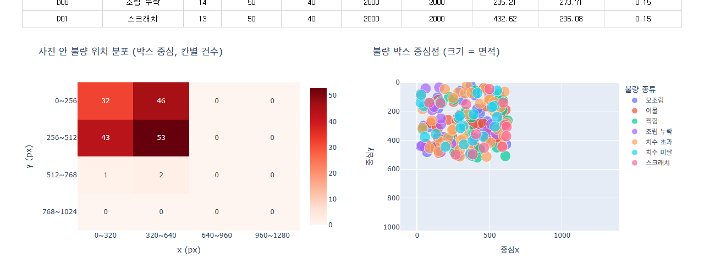

# 2026-11-24 O1 불량 박스 분석

- 작성자: jangjunseo05 (Claude Code와 작업)
- 브랜치 / PR: `feat/box-analysis`
- 관련 요구사항: O1

## 문제
로그에는 불량이 사진 어디서 발견됐는지(박스 좌표)가 있지만 쓰이지 않았다. 불량이 사진의 특정 위치에 몰리면 원인 추정에 쓸 수 있다(예: 조명·렌즈 문제, 지그 위치, 컨베이어 접촉부). 불량 종류별 크기는 심각도 판단의 근거가 된다.

## 판단
- **대상 기록**: NG이면서 D99가 아니고 좌표 4개가 모두 있는 기록만 쓴다. OK와 D99는 명세상 좌표가 비어 있다.
- **잘못된 좌표는 버리지 않고 드러낸다.** x2 ≤ x1, y2 ≤ y1, 사진(1280×1024) 밖인 박스는 평균을 왜곡한다. 분석에서는 빼되, 실행 로그에 건수와 일련번호를 남겨 데이터 품질 문제로 보고한다.
- **위치 분포는 박스 중심 기준 격자 칸 건수로 센다.** 4×4 격자(칸 320×256 px), 칸 수는 설정에서 바꾼다. 경계에 걸친 중심은 오른쪽·아래 칸, 사진 끝은 마지막 칸으로 센다. 빈 칸도 0으로 남겨 히트맵이 항상 같은 모양이 되게 했다.
- **화면 표현**: 표(종류별 평균 크기), 히트맵(칸별 건수, 사진 좌표처럼 위쪽이 y=0), 산점도(중심점, 점 크기 = 면적, 마우스를 올리면 일련번호 표시).
- **별도 모듈 `box.py`**([ADR-001](../decisions/ADR-001-feature-modules.md)). 화면 계산은 `build_box_view()`로 분리했다. `app.py`에는 집계 코드가 없다(D7 테스트 통과).

## 한 일
- `box.py`: `compute_boxes`(중심·크기·면적 + 잘못된 좌표 분리), `box_by_defect`, `position_grid`, `position_matrix`
- `main.py`: `box_by_defect.csv`, `box_position_grid.csv`, 잘못된 좌표 경고 로그
- `app.py`: 맨 아래에 O1 구역(표, 히트맵, 산점도). 시설·날짜·불량 종류 선택을 따른다
- `config`: `image_width`, `image_height`, `box_grid_cols`, `box_grid_rows` (`config.json`에 `count_d99_as_defect`도 명시)
- README, TEAM_README, AI_USAGE, collaboration 담당 표

## 검증
- 테스트 9개 먼저 작성(red) → 구현(green). 전체 **56 passed, 7 skipped** (skipped = 제공 데이터 필요)
  - 손 계산 예: (0,0,100,50) → 중심 (50,25), 면적 5,000. 스크래치 2건 평균 면적 (5,000+20,000)/2 = 12,500, 사진 대비 0.95%
  - 경계값: 중심 x = 320 → 열 1. 폭 0 박스 → 잘못된 좌표
- 합성 데이터로 `python main.py`: 박스 177건 분석, CSV 2종 생성 (격자 표 128행 = (전체+7종) × 16칸)
- 헤드리스 Edge로 대시보드를 캡처해 확인했다. 처음에는 합성 박스의 면적이 모두 같아 산점도 점이 최대 크기로 뭉쳐 보였다. `size_max`를 지정해 고쳤다
  
  (합성 박스는 x < 650, y < 540 범위에서 만들었으므로 왼쪽 위 4칸에만 몰린 것이 맞다)
- **실제 데이터로 확인할 것**: 잘못된 좌표 건수(`run_log.txt`), 불량 종류별 위치 편중, 종류별 크기 차이 → 발표의 "데이터 특이 사항" 재료

## 협업 메모
- hotspot 파일은 모두 구역 끝에 추가했다. 새 `build_view` 인자 `settings`는 기본값이 있어 기존 호출이 그대로 동작한다
- 고도화 4건(#9 O2, #10 글꼴, #11 D99, 이번 O1)을 모두 main에서 바로 딴 브랜치로 하나씩 머지해, 쌓은 브랜치 때문에 생기는 충돌을 피했다

## 포트폴리오 포인트
- 좌표 데이터를 **중심점·면적·격자 위치 분포**로 요약했다. **잘못된 좌표를 조용히 버리지 않고 품질 이슈로 보고**하도록 설계했다. 결과는 CSV와 히트맵·산점도 대시보드로 연결했고, 헤드리스 브라우저 캡처로 화면까지 확인했다.
